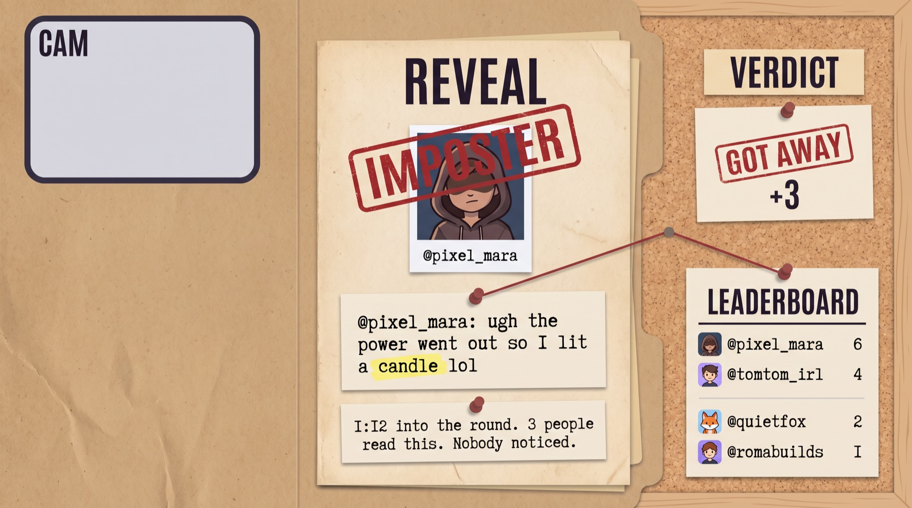

# Sus Word

Sus Word is a live Twitch chat game about hiding an ordinary word in plain sight. Players get a private role card, keep chatting, vote by stable player number, and watch the stream rewind the evidence.

## How a round works

1. Viewers type `!join`, open the private card, enter their exact Twitch name, then send the card's `!join CODE` command.
2. Each table gets one Imposter, or two at tables with 10–12 players. Every player keeps the same table number for the session.
3. The Imposter has three minutes to use it naturally in chat. Category and first-letter hints appear as time runs out.
4. Seated players vote with a number such as `2`, `#2`, `!2`, or `!vote 2`. Votes typed early are saved; voting closes as soon as every seated player has voted, otherwise it has a silent six-second grace period. Viewers without a card can vote too; their CHAT votes only break ties between seated votes.
5. The overlay rewinds chat, highlights the exact hidden word, reveals the verdict, shows the round leaders, and then deals new roles.

## Setup in 5 steps

1. Register a Twitch application. Set its OAuth redirect URL to `http://localhost:3000/auth/callback`.
2. Copy `.env.example` to `.env`, then add the Twitch client ID, client secret, bot login, and channel login. The bot and broadcaster may be the same account.
3. Install Node 24 and run `npm install`.
4. Run `npm run auth` once and authorize the requested chat scopes.
5. Run `npm start`. In OBS, add `http://localhost:3000/overlay` as a 1920×1080 browser source. For remote player cards, run `cloudflared tunnel --url http://localhost:3000`, put its public base URL in `PUBLIC_URL`, and restart Sus Word. Host controls accept only local requests. To operate `/host` remotely, set `HOST_SECRET` and open `/host?secret=YOUR_SECRET`.

Open `http://localhost:3000/host` for the detective-desk controls, player numbers, host-plays switch, streamer mic, and next bot-message preview. For an offline rehearsal, run `npm run demo -- --fast` and open the overlay; omit `--fast` for full three-minute timing. Add `--players 30` (up to 200) to rehearse multiple tables, and `--seed rehearsal-1` for a repeatable mix of catches and misses. Open `/card?demo=1` (or another player number) to view a simulated player's live card.

The v3 screens are built for a real stream: the first lobby teaches the rules, the round board shows stable numbers and active speakers, voting gets a large countdown, and the reveal stays below the camera before ending on the top three. The phone card handles joining, private roles, tap-to-vote, results, and the final Champion screen.

## Mixed rehearsal on your real channel

Testing alone? `npm run sim` connects to your real Twitch channel like `npm start` and seats three clearly labelled simulated players. Their names start with "Sim", their lines appear on the overlay and in the reveal, and they never post in Twitch chat. Join normally, then start rounds with `!sus go`: they chat, hide a word when dealt Imposter, and vote by number. Use `--players 5`, `--rounds 3`, `--fast`, or `--seed rehearsal-1` for repeatable rehearsals. The lobby waits for `!sus go`.

## Big chats: tables

One table is the whole game for a small stream. When more people claim cards, Sus Word deals them into tables of up to 12, and every table plays at the same time on one timer.

- A table of 3–9 players has one Imposter. A table of 10–12 has two, each with their own word.
- The table on stream (the featured table) plays in Twitch chat. Every other table talks in its own chat inside the phone card, so the main chat stays readable.
- `!accuse name word` is a live accusation: one shot per round, valid only after the word was smuggled. Right answer: that Imposter is busted on the spot.
- Viewers without a card are the crowd: they can accuse and vote on the featured table. Crowd votes appear as a separate CHAT bar and only break a tie between seated votes; they cannot choose a suspect by themselves.
- The streamer always sits at the featured table, so their voice only counts where everyone can hear it. Turn off **Host plays** to just host.
- The featured table rotates every round, and the host can pick any table. **FINAL** guarantees the top scorer from every table a seat, then adds the strongest runners-up for a final of at least six when enough players are available.

Tested in rehearsal with up to 200 virtual players; a 200-player round resolves in a few milliseconds.

`npm test` runs the fast, browser-free logic suite. `npm run test:browser` launches local Chrome and loads every overlay mock at 854×480, 1280×720, and 1920×1080, checking real computed layout for board-cell overflow, clipped fixture names, name/VOTE overlap, chat and voice reveal captions, stamps, the champion panel, the pre-leader reveal card, BUSTED rows in every phase, and console errors. It opens every card mock at 390×844, then opens real demo-mode Imposter and Detective cards and verifies the live secret role payloads render without console errors. Set `CHROME_PATH` if Chrome is not in a standard location.

## Streamer voice

Open the host page in Google Chrome and turn on **🎙 Mic**. Allow microphone access when Chrome asks. Final speech chunks count as the broadcaster's game messages, so the streamer can be suspected or can hide the word out loud as the Imposter. The broadcaster still needs to join and claim a card first.

## Chat commands

| Command | Who | What it does |
| --- | --- | --- |
| `!join` | Anyone | Gets the card link and joining help. `join` and `ijoin` work too. |
| `!join CODE` | Anyone | Joins and links the private card in one command. |
| `!claim CODE` | Anyone | Backward-compatible way to link a card. |
| `!leave` | Player | Leaves the game. |
| `2`, `#2`, `!2`, `!vote 2` | Player or crowd | Votes for that stable player number. A player's early vote is saved; crowd votes only resolve ties between seated votes and get no bot reply. |
| `!accuse name word` | Player or crowd | One live accusation per round. |
| `!sus start` | Broadcaster/mod | Opens the lobby. |
| `!sus go` | Broadcaster/mod | Starts a round. |
| `!sus vote` | Broadcaster/mod | Opens voting early. |
| `!sus next` | Broadcaster/mod | Moves from reveal to the next lobby. |
| `!sus end` | Broadcaster/mod | Ends the session. |
| `!sus mute name` | Broadcaster/mod | Removes a player from tables for the session. |
| `!sus help` | Anyone | Posts the short rules. |

## Private cards without viewer OAuth

The card page first checks that the Twitch name spoke in chat recently, then gives the viewer a short code tied to an HTTP-only browser session. They send `!join CODE` from that same Twitch account. The secret role goes only to that browser session; viewers never authorize a Twitch account, and a wrong account cannot consume the code.

## Built with Codex

Built in one Codex thread ([prompts in `codex-log/`](codex-log/)); the first rehearsal simulator was drafted outside Codex and later rewritten in Codex (step 15). The current game is covered by 132 browser-free automated tests, plus the real-Chrome mock and live-card check:

1. Pure game logic, word detection, scoring, and tests.
2. Twitch OAuth, EventSub chat, server routes, and live state.
3. The Case File overlay, private mobile cards, reveal animation, and host controls.
4. Offline rehearsal mode and streamer documentation.
5. Streamer voice through the Web Speech API.
6. The detective-desk host page from an approved design frame and generated image assets.
7. The photo-real overlay and phone card.
8. Screens that hold up with 30+ players.
9. Tables, live accusations, crowd play, and the final table.
10. Table screens, phone table chat, and the streamer's seat.
11. Playtest-driven joining, stable numbers, number voting, and clearer bot messages.
12. The v3 phone card, motion cues, vote grid, and delayed private results.
13. The v3 stream overlay and full reveal timeline.
14. Reveal and 480p readability polish.
15. A deterministic real-channel simulator whose players never post to Twitch.
16. Dynamic reveal timing, live accusation slams, round MVPs, host polish, and Champion screens.
17. Live overlay stability and first-render safety, crowd tie-break voting, legibility, card-state preservation, and case-file chat summaries.
18. A 480p vote-board pass that removed the padding regression for the 12 reviewed fixture names; its test measures the 73.7 px name-column budget at 854×480 without claiming browser font measurement.
19. The strict 480p vote-board re-check, reliable join replies, accurate case-file copy, and partial CHAT tie-breaks.
20. Reveal-board regression fixes, readable payoff copy, spoiler-safe case-file timing, and honest layout-budget coverage.
21. Case-file headline and miss-frame polish, readable vote totals, final standings, real Chrome layout checks, and push CI.
22. Host-control security, all-busted early reveals, live Imposter counts, durable accusation slams, reveal overflow checks, stronger finals, and live demo cards.
23. Phase-driven demo rounds, repeatable varied outcomes, persistent BUSTED states, early vote completion, table labels, and reveal-transition polish.
